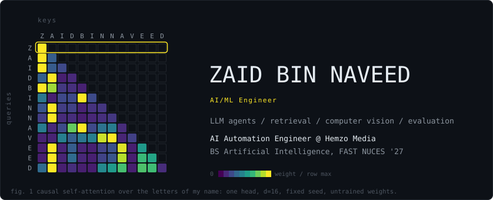

I build applied AI systems (LLM agents, retrieval, computer vision, and evaluation tooling) and I care most about the part that makes them trustworthy: a measurable claim, a reproducible setup, and an honest statement of what the system cannot do.

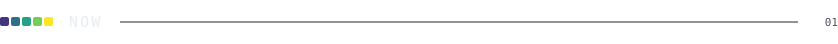

- **Hemzo Media** (Sep 2026 – present): designing agentic workflows and LLM-backed automation pipelines in production.
- **HealWright**: self-healing Playwright selectors that verify every heal before trusting it.
- **FAST NUCES**: final year of a BS in Artificial Intelligence (computer vision, AI engineering, agentic systems).

Previously: **AI Intern at FlyRank AI** (Jun – Aug 2026), retrieval evaluation and a content-opportunity scoring model.

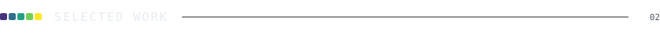

  <a href="https://github.com/zaidbinnaveed/HealWright">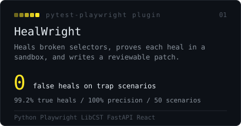</a>
  <a href="https://github.com/zaidbinnaveed/AI-Engineering-Assignment-01">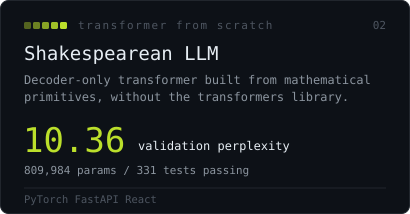</a>

  <a href="https://github.com/zaidbinnaveed/Cereberus">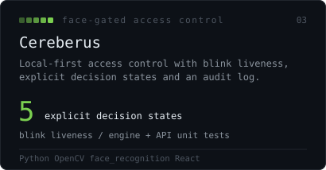</a>
  <a href="https://github.com/zaidbinnaveed/FlyRank-ML-Internship">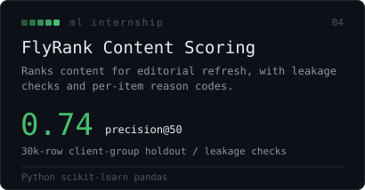</a>

  <a href="https://github.com/zaidbinnaveed/Spidey">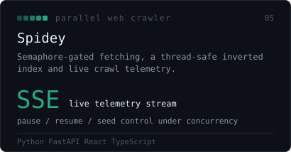</a>
  <a href="https://github.com/zaidbinnaveed/HireSense-AI">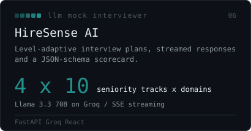</a>

The transformer has a long-form [write-up on Medium](https://medium.com/@zaidbinnaveed04/building-gpt-from-scratch-the-mathematics-architecture-training-and-engineering-behind-our-8e13a74ea747). Also: [**Movify**](https://github.com/zaidbinnaveed/Movify) (explainable recommenders) · [**Derm Nexus AI**](https://github.com/zaidbinnaveed/Derm-Nexus-AI) (EfficientNet-B3 lesion classifier, end to end).

**Machine learning:** Python · PyTorch · scikit-learn · pandas · NumPy · OpenCV  
**Applied AI:** LLM agents · RAG and retrieval · Computer vision · Evaluation and benchmarking · Recommender systems  
**Product engineering:** React · TypeScript · Next.js · FastAPI · REST · Server-Sent Events  
**Delivery:** Git · GitHub Actions · Docker · Vercel · Railway · Render

1. **State the constraint first.** Privacy, latency, data access, and failure modes should shape the solution.
2. **Keep evidence close to the claim.** Setup, architecture, limitations, and evaluation belong beside the code.
3. **Treat UX as part of correctness.** A model output is only useful when a person can understand and act on it.
4. **Prefer honest scope over inflated language.** Prototype, academic project, and production system are different things.

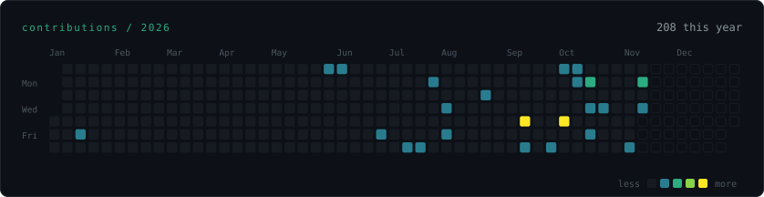

  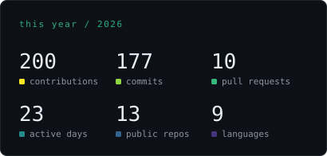
  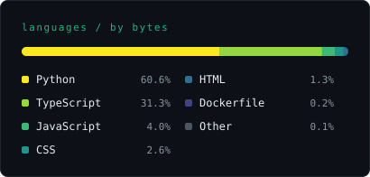

[Portfolio](https://zaid-portfolio-drab.vercel.app/) · [LinkedIn](https://www.linkedin.com/in/zaid-bin-naveed-b34559293/) · [Email](mailto:zaidbinnaveed04@gmail.com) · [X](https://x.com/ZaidBinNaveed)

Every image on this page is generated by the scripts in this repository and refreshed daily by <a href="./.github/workflows/refresh.yml">GitHub Actions</a>; no third-party widgets. The palette is viridis, the colormap of the transformer's own attention plots.
